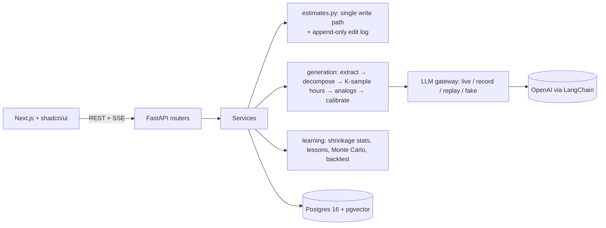

# Calibr — a self-learning software project estimator

Internal pre-sales estimation: upload a brief → AI extracts requirements and proposes
**modules → tasks** with role, category and a min–max hour range → the PM edits in a spreadsheet-like
editor or via an AI agent (reviewable diffs) → finalize → enter actuals → deliver.

**The differentiator:** every edit a PM makes to the AI draft, and every delivered hour, is logged
(append-only) and used to calibrate the next estimate — transparently. Each number has a
"Why this number?" view (source quote, raw LLM samples, analogs, calibration factor and its evidence),
and a backtest page measures whether learning actually helps.

## Quickstart

```bash
cp .env.example .env        # LLM_MODE=fake works offline; set OPENAI_* + LLM_MODE=live for real LLM
make up                     # db + backend + frontend; migrations run on backend start
make seed                   # idempotent demo history (20 synthetic delivered projects)
open http://localhost:3000  # API docs: http://localhost:8000/docs
make backtest               # CLI backtest (no LLM calls)
make test                   # backend tests (inside the backend container)
```

Then follow [docs/DEMO.md](docs/DEMO.md).

## Architecture



More: [docs/ARCHITECTURE.md](docs/ARCHITECTURE.md) · [docs/DECISIONS.md](docs/DECISIONS.md) ·
[docs/DATASETS.md](docs/DATASETS.md)

## How learning works (summary)

* Every AI task stores an immutable **raw LLM baseline** (median of K samples). Learning always
  compares against the raw value, never against numbers the system already calibrated.
* Two layers in log space: **edit** (PM final / raw) at quote time, **actual** (delivered / raw) after
  delivery. Stats are recomputed from scratch per scope (global → category → PM) with hierarchical
  shrinkage; the edit layer is the prior for the actual layer.
* New tasks: `raw_mid × exp(μ)`, then blended with similar past tasks (analogs) in log space; ranges are
  lognormal P10–P90; project totals come from a Monte Carlo with a shared project factor (P50/P80).
* Lessons are short text rules proposed from the evidence; a human must approve them.
* Backtest (leave-one-project-out / chronological, no leakage, no LLM calls) compares a naive median,
  raw LLM, +analogs, +edit calibration and the full system, with bootstrap CIs.

Full math and hyperparameters: [docs/LEARNING.md](docs/LEARNING.md).

## Screenshots

_Placeholder — add screenshots of Projects, Estimate editor + Agent, "Why this number?", Insights and
Backtest._

## Privacy & security notes

* In `live`/`record` mode client documents are sent to OpenAI. `LLM_REDACT_PII` is a documented stub
  (off) — redaction is future work.
* Uploads: 15 MB limit, extension allowlist (PDF/DOCX/MD/TXT). Document text is never logged at INFO.
* Demo-only identity via `X-User-Id`; there is no real authentication.

## Repository layout

`backend/` FastAPI app (`app/api`, `app/services`, `app/agents`, `app/llm`, `app/prompts`,
`app/db`), Alembic, scripts, tests · `frontend/` Next.js App Router + shadcn/ui · `data/fixtures/`
committed demo briefs and LLM cache · `docs/`.