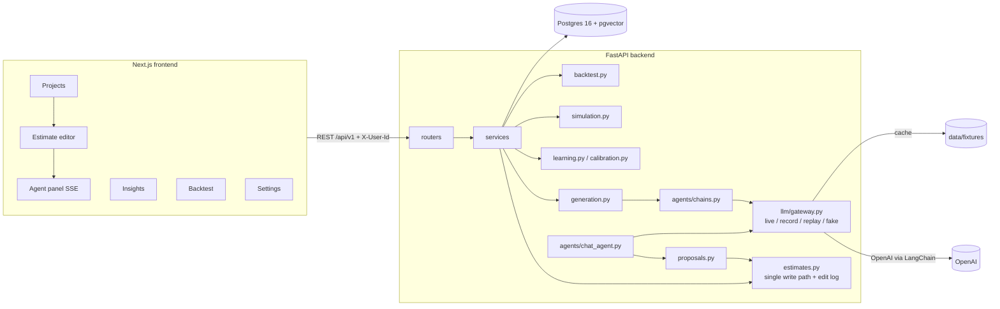

# Architecture

## Layers

* **Routers (`app/api`)** — validation and HTTP only. Consistent error shape
  `{error: {code, message, details}}` via exception handlers in `main.py`.
* **Services (`app/services`)** — all business logic. `estimates.py` is the *only* code that writes
  tasks/modules; each change writes `edit_events` in the same transaction (callers commit).
* **LLM (`app/llm`, `app/agents`, `app/prompts`)** — one gateway for every call: retries,
  `llm_calls` logging (tokens, latency, estimated cost), cache record/replay, and a deterministic
  `fake` mode. Structured output via `with_structured_output(include_raw=True)`. Prompts are versioned
  Markdown files; versions are recorded in baselines and `model_snapshot`.
* **Chat agent** — LangChain 1.x `create_agent` (LangGraph runtime) with tools that are read-only or
  append ops to a `change_proposal`. Streams over SSE (`session`, `token`, `tool`, `proposal`,
  `done`, `error`). Accepting an op applies it through `estimates.py` with `actor=agent` and
  `proposal_id`; rejections are logged as `proposal_op_rejected`.
* **Jobs** — generation and backtests run as FastAPI `BackgroundTasks` with a `jobs` row the UI polls.

## Data integrity

* `edit_events` and `task_ai_baselines` have `BEFORE UPDATE` triggers that raise — rows are
  append-only/immutable at the database level.
* Final estimates are read-only (service layer); clone to create a new draft version.
* All demo rows carry `projects.data_source` (`synthetic` / `dataset`) and are badged in the UI.

## Generation pipeline

ingest (parse, line-preserving chunks, embeddings) → extraction (requirements must cite chunk ids;
one retry on invalid citations) → decomposition (fixed task list, hidden tasks enforced) →
estimation (K samples on the fixed list, per-task median; all samples stored in
`llm_raw_estimates`) → analog retrieval (other projects with final estimates only) → calibration →
baselines + provenance → clarifying questions → Monte Carlo summary. `learning=false` uses the same
path and simply skips retrieval/calibration.
