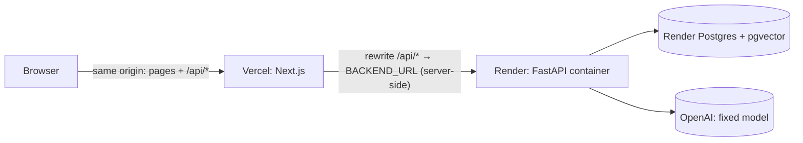

# Deployment

| Part | Host | URL |
|---|---|---|
| Frontend (Next.js) | Vercel project `project-calibrate` | https://project-calibrate.vercel.app |
| API (FastAPI, Docker) | Render web service `project-calibrate-api` (Blueprint: [render.yaml](../render.yaml)) | https://project-calibrate-api.onrender.com (planned name — Render may add a suffix) |
| Database | Render Postgres 16 `project-calibrate-db` + pgvector | private to Render |



The browser only ever talks to the Vercel domain. `/api/*` is proxied server-side to Render, so the session and
CSRF cookies are first-party (`HttpOnly; Secure; SameSite=Lax`) and no CORS is involved. The agent stream is SSE
with `Cache-Control: no-transform`; if a proxy buffers it, the UI falls back to polling after 20 s.

## Status

* Frontend: deployed and live (landing, help, sign-in pages). `BACKEND_URL` and `PUBLIC_APP_URL` are set on the
  Vercel project (Production).
* API + database: **not yet deployed** — needs the Render steps below (Render login + secrets are the owner's).
  Until then `/api/*` on the Vercel URL returns 404 and sign-in does not work.
* The whole path (production image → empty Postgres → archive seed → production Next build → sign-in →
  live estimate → streamed agent run) was rehearsed locally: `make deploy-check` 21/21 passed (see
  [DECISIONS.md](DECISIONS.md) #63).

## Deploy the API on Render (one time, ~10 minutes)

1. Push this repository to GitHub (`git push origin main`).
2. Render Dashboard → **New → Blueprint** → pick the repository → Render reads `render.yaml` and proposes the
   web service `project-calibrate-api` and the database `project-calibrate-db`.
3. Fill the secrets it asks for:
   * `OPENAI_API_KEY`
   * `ADMIN_EMAIL` and `ADMIN_PASSWORD` (10+ characters) — this account becomes the admin and the owner of
     the seeded archive.
   `SESSION_SECRET` is generated by Render; everything else has a value in `render.yaml`.
4. **Apply**. The first deploy builds `deploy/backend.Dockerfile`, then on start: `alembic upgrade head`
   (creates the `vector` extension and schema) → `python -m scripts.seed_archive` (no-op unless the archive file
   is baked in) → `uvicorn`. The first boot creates the admin from `ADMIN_EMAIL`/`ADMIN_PASSWORD`.
   Health check: `/health`.
5. Check the service URL Render assigned. If it is not exactly `https://project-calibrate-api.onrender.com`,
   update Vercel and redeploy the frontend:
   ```bash
   cd frontend
   npx vercel env rm BACKEND_URL production -y
   printf "https://<your-service>.onrender.com" | npx vercel env add BACKEND_URL production
   npx vercel deploy --prod
   ```
6. Load your test data: see [The admin archive](#the-admin-archive-your-existing-test-data) below.
7. Verify:
   ```bash
   make deploy-check URL=https://project-calibrate.vercel.app
   # with sign-in checks (values are read from the environment, never printed):
   DEPLOY_CHECK_EMAIL=... DEPLOY_CHECK_PASSWORD=... make deploy-check URL=https://project-calibrate.vercel.app
   # plus one live estimate and a streamed agent run (~1 cent):
   DEPLOY_CHECK_AI=1 DEPLOY_CHECK_EMAIL=... DEPLOY_CHECK_PASSWORD=... make deploy-check URL=https://project-calibrate.vercel.app
   ```

## The admin archive (your existing test data)

`deploy/seed/admin_archive.sql.gz` is a data-only copy of the local test data (28 projects, 581 tasks,
backtests, calibration, agent history), built by `make admin-archive`
([scripts/make_admin_archive.sh](../scripts/make_admin_archive.sh)) from a scratch copy of the dev database with
**all password hashes removed** and sessions, login attempts, reset tokens and jobs excluded. It contains no API
keys or secrets, but it does contain your test projects, so it is **not committed** (the GitHub repo is public).

Load it into Render once, from this machine, after the first deploy is live:

1. Render Dashboard → `project-calibrate-db` → **Connect → External Database URL** (copy it; do not commit it).
2. Run (idempotent — it only loads into a database that has no projects yet):
   ```bash
   make admin-archive    # refresh the dump from the local dev database (optional)
   DATABASE_URL='<External Database URL>' ADMIN_EMAIL='<same ADMIN_EMAIL as on Render>' scripts/restore_admin_archive.sh
   ```
3. Render → `project-calibrate-api` → **Manual Deploy → Restart service**. On boot the API sets the admin
   password from `ADMIN_PASSWORD` (the archive's owner was renamed to `ADMIN_EMAIL`, so you own the archive).

Notes:

* Other archive users stay archived and cannot sign in.
* If you prefer the API to load it by itself on first boot, the image includes `deploy/seed/` when the file is
  present in the build context and `SEED_ARCHIVE=true` (set in `render.yaml`); that requires committing the
  file, which this repo does not do.
* Uploaded original files are not part of the archive (Render's free plan has no persistent disk); extracted
  document text and chunks are, so retrieval and "Why this number?" work.

## Reviewer access

`AUTH_MODE=quick` (set in `render.yaml`): no accounts or passwords for users.

1. Open https://project-calibrate.vercel.app → **Get started** (or **Sign in**).
2. Enter a name (email optional — entering the same email later returns to the same projects) → **Continue**.
3. A welcome dialog and an 8-step tour start once; the dashboard checklist tracks progress.

The administrator still signs in with `ADMIN_EMAIL`/`ADMIN_PASSWORD` ("Administrator? Sign in with a password").
Users see their own projects and those shared with them; the admin sees everything and can switch on
"include archive for all" in **Admin → Data archive** so everyone's estimates learn from the archive.
To go back to full accounts set `AUTH_MODE=password` and `SIGNUP_MODE=invite` + `INVITE_CODE`.

### 3-minute guide

1. **Projects → New project**, then **Paste an example brief** on the Overview tab.
2. **Estimate → Generate** (about 30–60 s with the live model).
3. Open the **Agent** panel: try `/similar`, "Reduce QA by 20%", or select rows and "add 10% to these".
   Each change shows as a tool card with Undo.
4. Click a task's **Why this number?** button (source passage, raw samples, calibration, analogs).
5. **Insights** and **Backtest** show the evidence (sample sizes are always shown).

## Limits and costs

* Model fixed to `gpt-6-luna` (`reasoning_effort=none`); embeddings `text-embedding-3-small`.
* `LLM_BUDGET_USD=3.00` total; `USER_DAILY_USD_CAP=0.50` per user per day; 60 AI requests per user per hour;
  2 concurrent runs per user. Admins can lower individual caps in **Admin → Users**.
* Render free plan: the API sleeps after ~15 minutes idle; the first request afterwards can take ~1 minute
  (the UI shows a retry card if the agent call times out). The free database expires after 30 days unless
  upgraded — see [KNOWN_ISSUES.md](KNOWN_ISSUES.md).

## Updating

* API: push to `main` (Render auto-deploys on changes under `backend/`, `deploy/` or `render.yaml`).
  Migrations are additive and run on start.
* Frontend: `cd frontend && npx vercel deploy --prod` (or connect the Vercel project to the GitHub repo with
  root directory `frontend`).
* Never point a production service at `LLM_MODE=fake`/`replay` — the API refuses to start.

## Prompt 6 redeploy (VND, fixed-height agent panel, coloured tags)
- Code SHA deployed: `386dec0` (pushed to `main`; Render and Vercel auto-deploy from Git).
- Frontend: https://project-calibrate.vercel.app. API through the same-site proxy: https://project-calibrate.vercel.app/api/v1 (Render service behind it).
- `/api/v1/ready` reports migration `0006` (applied on Render start; additive).
- `make deploy-check URL=https://project-calibrate.vercel.app`: 14 passed, 0 failed, 1 skipped (password sign-in needs env vars).
- Live Playwright pass (`e2e/live-prod.spec.ts`, 19 Oct 2026, ~23:05 UTC, 1280x720): quick sign-in as a new guest "Release check", real-model estimate, VND shown by default (cost-mid 285 triệu), USD toggle saved and persisted after reload, composer in view with the page not scrolling, real-model chat message "Reduce all backend tasks by 10%" changed the table, role tags rendered, sign-out. 1 passed.
- The live pass created guest members and projects named "Release check…"/"curl check/curl proj" in the production database (test data, removable by the admin).
- Render's small instance reset a few connections while estimate jobs ran; earlier live runs failed on that and on spec races (spec hardened), not on the app.

## Test residue cleanup and production state (20 Oct 2026)
- Live checks now tag everything with a `CALIBR-RUN-<id>` prefix and remove it in `finally`: `e2e/live-prod.spec.ts` signs in as a guest named `CALIBR-RUN-<id> guest` and calls `DELETE /api/v1/auth/me` at the end (new guest-only endpoint: deletes that guest, its projects and sessions; admins, password accounts and archived data are refused with 403). `make deploy-check` tags its projects and deletes them in `finally`.
- Verified live: the spec run `CALIBR-RUN-mvfxgmz2` ended with `DELETE /auth/me -> 204`; the earlier "curl check" guest was removed the same way (204, then `/auth/me` 401).
- Leftovers from before the prefix (guests named "Release check", "curl check"; projects "Release check …", "curl proj") remain in production. This session has no production `DATABASE_URL` (the one in the environment points to `localhost/calibr`), so nothing was run against production. Dry-run against local dev DB: 0 users, 0 projects matched. Production matched counts: not recorded (not run).
- To clean production, from a shell with the production `DATABASE_URL` exported (read it from the Render dashboard; do not paste it anywhere):
  ```
  scripts/cleanup_test_residue.sh            # dry run: lists users and projects (owner, created_at, name); exit 2 = refused
  scripts/cleanup_test_residue.sh --confirm  # deletes exactly the listed guests and their projects
  ```
  It matches only non-admin, non-archived `@guest.calibr` users named "Release check", "curl check" or `CALIBR-RUN-*` and projects named "Release check *", "curl proj" or `CALIBR-RUN-*`; it refuses if a matched project is owned by anyone else (including the admin) or a matched guest owns any other project.
- Landing page: all 49 images in `frontend/public/landing` and `frontend/public/help` are byte-identical on the live site (SHA-256) and show VND amounts, the fixed-height chat with the pinned composer, collapsed tool cards and coloured role/category tags. The "Screenshots show fictional sample data." footnote is present on the live landing page. No regeneration or frontend redeploy was needed.
- Production: `/api/v1/ready` = `{"status":"ready","migration":"0006"}`, `/api/v1/health` = ok, DB true. `make deploy-check`: 14 passed, 0 failed, 1 skipped.
- Deployed commit: `d5a6009` (backend serves `DELETE /auth/me`; the frontend assets match this commit). Render exposes no commit endpoint, so this is inferred from that behaviour. `main` equals `origin/main` at `d5a6009`; the only later commit is this docs change (docs-only difference).
