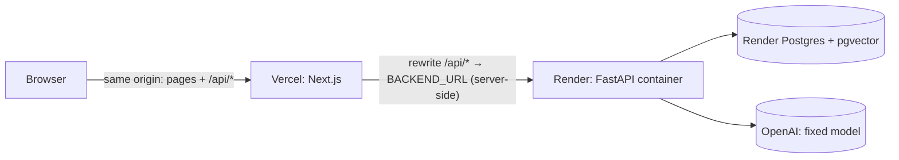

# Deployment

| Part | Host | URL |
|---|---|---|
| Frontend (Next.js) | Vercel project `project-calibrate` | https://project-calibrate.vercel.app |
| API (FastAPI, Docker) | Render web service `project-calibrate-api` (Blueprint: [render.yaml](../render.yaml)) | https://project-calibrate-api.onrender.com (planned name — Render may add a suffix) |
| Database | Render Postgres 16 `project-calibrate-db` + pgvector | private to Render |



The browser only ever talks to the Vercel domain. `/api/*` is proxied server-side to Render, so the session and
CSRF cookies are first-party (`HttpOnly; Secure; SameSite=Lax`) and no CORS is involved. The agent stream is SSE
with `Cache-Control: no-transform`; if a proxy buffers it, the UI falls back to polling after 20 s.

## Status

* Frontend: deployed and live (landing, help, sign-in pages). `BACKEND_URL` and `PUBLIC_APP_URL` are set on the
  Vercel project (Production).
* API + database: **not yet deployed** — needs the Render steps below (Render login + secrets are the owner's).
  Until then `/api/*` on the Vercel URL returns 404 and sign-in does not work.
* The whole path (production image → empty Postgres → archive seed → production Next build → sign-in →
  live estimate → streamed agent run) was rehearsed locally: `make deploy-check` 21/21 passed (see
  [DECISIONS.md](DECISIONS.md) #63).

## Deploy the API on Render (one time, ~10 minutes)

1. Push this repository to GitHub (`git push origin main`).
2. Render Dashboard → **New → Blueprint** → pick the repository → Render reads `render.yaml` and proposes the
   web service `project-calibrate-api` and the database `project-calibrate-db`.
3. Fill the four secrets it asks for:
   * `OPENAI_API_KEY`
   * `ADMIN_EMAIL` and `ADMIN_PASSWORD` (10+ characters) — this account becomes the admin and the owner of
     the seeded archive.
   * `INVITE_CODE` (8+ characters) — give it to reviewers so they can create accounts.
   `SESSION_SECRET` is generated by Render; everything else has a value in `render.yaml`.
4. **Apply**. The first deploy builds `deploy/backend.Dockerfile`, then on start: `alembic upgrade head`
   (creates the `vector` extension and schema) → `python -m scripts.seed_archive` (no-op unless the archive file
   is baked in) → `uvicorn`. The first boot creates the admin from `ADMIN_EMAIL`/`ADMIN_PASSWORD`.
   Health check: `/health`.
5. Check the service URL Render assigned. If it is not exactly `https://project-calibrate-api.onrender.com`,
   update Vercel and redeploy the frontend:
   ```bash
   cd frontend
   npx vercel env rm BACKEND_URL production -y
   printf "https://<your-service>.onrender.com" | npx vercel env add BACKEND_URL production
   npx vercel deploy --prod
   ```
6. Load your test data: see [The admin archive](#the-admin-archive-your-existing-test-data) below.
7. Verify:
   ```bash
   make deploy-check URL=https://project-calibrate.vercel.app
   # with sign-in checks (values are read from the environment, never printed):
   DEPLOY_CHECK_EMAIL=... DEPLOY_CHECK_PASSWORD=... make deploy-check URL=https://project-calibrate.vercel.app
   # plus one live estimate and a streamed agent run (~1 cent):
   DEPLOY_CHECK_AI=1 DEPLOY_CHECK_EMAIL=... DEPLOY_CHECK_PASSWORD=... make deploy-check URL=https://project-calibrate.vercel.app
   ```

## The admin archive (your existing test data)

`deploy/seed/admin_archive.sql.gz` is a data-only copy of the local test data (28 projects, 581 tasks,
backtests, calibration, agent history), built by `make admin-archive`
([scripts/make_admin_archive.sh](../scripts/make_admin_archive.sh)) from a scratch copy of the dev database with
**all password hashes removed** and sessions, login attempts, reset tokens and jobs excluded. It contains no API
keys or secrets, but it does contain your test projects, so it is **not committed** (the GitHub repo is public).

Load it into Render once, from this machine, after the first deploy is live:

1. Render Dashboard → `project-calibrate-db` → **Connect → External Database URL** (copy it; do not commit it).
2. Run (idempotent — it only loads into a database that has no projects yet):
   ```bash
   make admin-archive    # refresh the dump from the local dev database (optional)
   DATABASE_URL='<External Database URL>' ADMIN_EMAIL='<same ADMIN_EMAIL as on Render>' scripts/restore_admin_archive.sh
   ```
3. Render → `project-calibrate-api` → **Manual Deploy → Restart service**. On boot the API sets the admin
   password from `ADMIN_PASSWORD` (the archive's owner was renamed to `ADMIN_EMAIL`, so you own the archive).

Notes:

* Other archive users stay archived and cannot sign in.
* If you prefer the API to load it by itself on first boot, the image includes `deploy/seed/` when the file is
  present in the build context and `SEED_ARCHIVE=true` (set in `render.yaml`); that requires committing the
  file, which this repo does not do.
* Uploaded original files are not part of the archive (Render's free plan has no persistent disk); extracted
  document text and chunks are, so retrieval and "Why this number?" work.

## Reviewer access

1. Open https://project-calibrate.vercel.app → **Get started**.
2. Sign up with the invite code from the owner (sign-up mode `invite`).
3. A welcome dialog and an 8-step tour start once; the dashboard checklist tracks progress.

Reviewers are members: they see their own projects and those shared with them. The admin sees everything,
including the archive, and can toggle "include archive for all" in **Admin → Data archive** so members' learning
uses it too.

### 3-minute guide

1. **Projects → New project**, then **Paste an example brief** on the Overview tab.
2. **Estimate → Generate** (about 30–60 s with the live model).
3. Open the **Agent** panel: try `/similar`, "Reduce QA by 20%", or select rows and "add 10% to these".
   Each change shows as a tool card with Undo.
4. Click a task's **Why this number?** button (source passage, raw samples, calibration, analogs).
5. **Insights** and **Backtest** show the evidence (sample sizes are always shown).

## Limits and costs

* Model fixed to `gpt-6-luna` (`reasoning_effort=none`); embeddings `text-embedding-3-small`.
* `LLM_BUDGET_USD=3.00` total; `USER_DAILY_USD_CAP=0.50` per user per day; 60 AI requests per user per hour;
  2 concurrent runs per user. Admins can lower individual caps in **Admin → Users**.
* Render free plan: the API sleeps after ~15 minutes idle; the first request afterwards can take ~1 minute
  (the UI shows a retry card if the agent call times out). The free database expires after 30 days unless
  upgraded — see [KNOWN_ISSUES.md](KNOWN_ISSUES.md).

## Updating

* API: push to `main` (Render auto-deploys on changes under `backend/`, `deploy/` or `render.yaml`).
  Migrations are additive and run on start.
* Frontend: `cd frontend && npx vercel deploy --prod` (or connect the Vercel project to the GitHub repo with
  root directory `frontend`).
* Never point a production service at `LLM_MODE=fake`/`replay` — the API refuses to start.
